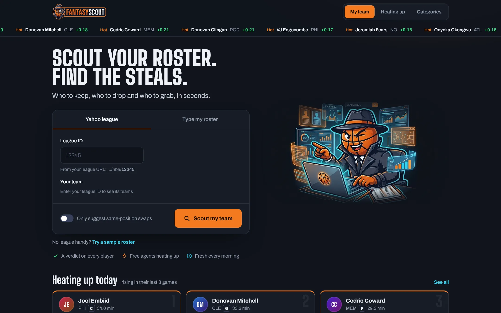
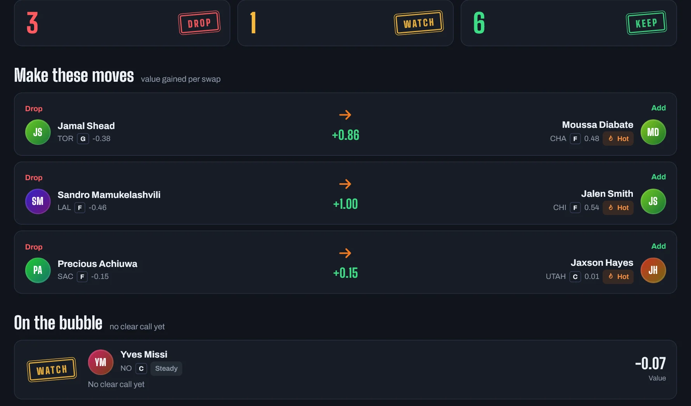
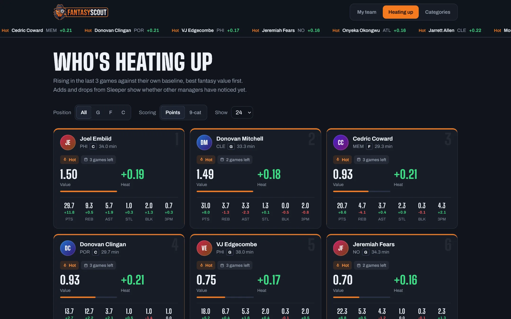
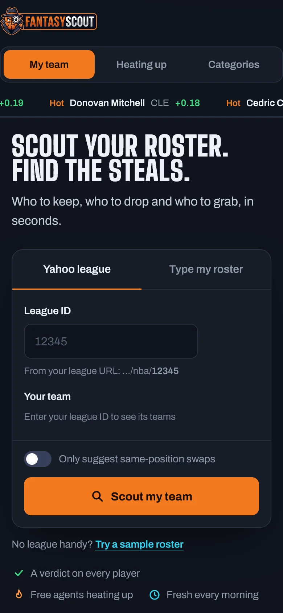
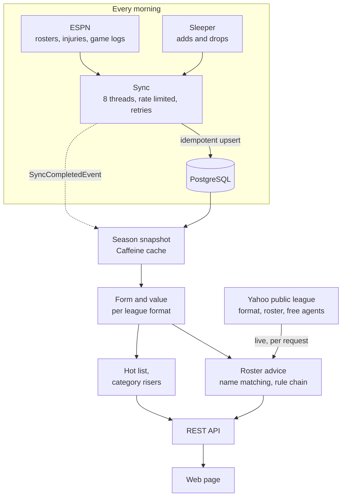

<p align="center">
  
</p>

<p align="center">
  <b>Your NBA fantasy scout.</b> It reads every player's recent form each morning and tells you who to keep,
  who to drop and which free agents to grab.
</p>

<p align="center">
  <a href="https://nba-fantasy-scout-1.onrender.com"></a>
  
  
  
  <a href="https://github.com/leibori/nba-fantasy-scout/actions/workflows/daily-sync.yml"></a>
</p>

<p align="center">
  <a href="https://nba-fantasy-scout-1.onrender.com"><b>Try it live</b></a>: use your public Yahoo league, or click
  "Try a sample roster". On the free host the first visit can take up to a minute while the server wakes up.
</p>

<p align="center">
  
</p>

## What it does

| | |
|---|---|
| **Keep, watch or drop** | Bring a public Yahoo league (or type your roster) and get a verdict on every player you own, each drop paired with the free agent to pick up instead. The league's own format is read from Yahoo: points or 9-cat. |
| **Who's heating up** | Players rising in their last 3 games against their own baseline, ranked by fantasy value, filterable by position and scoring format. |
| **Category risers** | The biggest jump per game in one category (points, rebounds, blocks, FG%...), for 9-cat streaming. |
| **What the crowd is doing** | Adds and drops from Sleeper, cross-checked with the stats: a confirmed breakout, hype, an early pickup nobody has noticed, or a panic drop worth holding. |

<p align="center">
  
</p>

<table>
  <tr>
    <td width="66%"></td>
    <td width="34%"></td>
  </tr>
</table>

## How it decides

Two numbers per player, because "better than before" and "good right now" are different questions:

- **Heat**: his last 3 games against his own earlier games, built from minutes, shot attempts and usage, not from
  shooting luck. Early in the season, before he has 5 games, it compares with last season.
- **Value**: how good he is right now against every NBA player in real minutes this season, as a z-score. For 9-cat
  it sums the nine categories, with FG% and FT% weighted by volume; for points leagues it uses the league's own
  point values.

Together they give a form (hot, returning, good, steady, cold), and a chain of rules turns form, value, injuries
and crowd signals into the verdict. A player is dropped only when a healthy free agent is clearly better, by a
margin set per format so that noise doesn't trigger swaps.

## Under the hood



**Engineering highlights**

- **Concurrent ingestion:** game logs for ~525 players fetched in parallel on a thread pool behind a shared rate
  limiter, with retries and exponential backoff. The daily sync went from **162 s to 47 s** (8 threads), capped by
  the source's rate limit rather than by threads.
- **Idempotent writes:** one batch upsert, `INSERT ... ON CONFLICT DO UPDATE ... WHERE ... IS DISTINCT FROM`, so new
  games are inserted, stat corrections applied and unchanged rows never rewritten.
- **Caching:** the season snapshot is computed once and cached (about **860 ms cold, 30 ms per request** after),
  with stampede protection so concurrent cold requests compute it once. A `SyncCompletedEvent` refreshes it.
- **Long work over HTTP:** `POST /sync/daily` returns **202** with a job id to poll; a compare-and-set keeps it to
  one sync at a time, and the job id is the log correlation id across all worker threads.
- **Modern Java design:** sealed interfaces and pattern-matching `switch` (`LeagueScoring`, `Recommendation`), the
  Strategy pattern for scoring, a Chain of Responsibility for roster rules, records for the domain, and a domain
  layer with no Spring or database in it.
- **Name matching without ids:** Yahoo and Sleeper don't share ESPN's ids, so names are matched by a hand-written
  normalizer (accents, initials, case) and Levenshtein distance, and weak matches are flagged.
- **Safe to share:** security headers (CSP, frame and content-type protection), a per-visitor limit on roster checks,
  a token on the sync endpoint, and output rendered as text so nothing from Yahoo can run as script.
- **Tested:** 109 tests: JUnit 5 for the domain logic, Mockito for services, `@WebMvcTest` for the web layer and
  Testcontainers for the database, including the upsert.

## API

| Endpoint | |
|---|---|
| `POST /api/v1/roster/from-yahoo` | Advice for a team in a public Yahoo league: `{ "leagueId": 12345, "teamName": "...", "samePosition": false }` |
| `POST /api/v1/roster` | The same advice for typed names: `{ "myRoster": [...], "freeAgents": [...] }` |
| `GET /api/v1/recommendations/hot` | Players heating up; `?position=G\|F\|C`, `?scoring=points\|categories`, `?limit=` |
| `GET /api/v1/recommendations/{category}` | Biggest risers in one category: `pts`, `reb`, `ast`, `stl`, `blk`, `threes`, `fg_pct`, `ft_pct`, `to` |
| `GET /api/v1/players/{id}/trend` | One player by ESPN id |
| `POST /api/v1/sync/daily` | Starts the daily sync (needs the `X-Sync-Token` header), returns 202 and a job |
| `GET /api/v1/sync/jobs/{jobId}` | A sync job's status and result |

Interactive docs: [Swagger UI](https://nba-fantasy-scout-1.onrender.com/swagger-ui.html).

<details>
<summary>Example: roster advice</summary>

```bash
curl -X POST https://nba-fantasy-scout-1.onrender.com/api/v1/roster \
  -H "Content-Type: application/json" \
  -d '{"myRoster": ["Jamal Shead", "Joel Embiid"], "freeAgents": ["Moussa Diabate", "Grayson Allen"]}'
```

```json
{
  "roster": [
    {
      "name": "Jamal Shead",
      "advice": "DROP",
      "reason": "Moussa Diabate is worth 0.86 more",
      "player":      { "name": "Jamal Shead",    "team": "TOR", "position": "G", "form": "NEUTRAL", "value": -0.377, "hotScore": 0.004 },
      "replacement": { "name": "Moussa Diabate", "team": "CHA", "position": "F", "form": "HOT",     "value": 0.483,  "hotScore": 0.192 }
    },
    {
      "name": "Joel Embiid",
      "advice": "KEEP",
      "reason": "Form: HOT",
      "player": { "name": "Joel Embiid", "team": "PHI", "position": "C", "form": "HOT", "value": 1.506, "hotScore": 0.194 }
    }
  ]
}
```

(Trimmed: each player also carries his recent and baseline stat lines and the crowd signal.)
</details>

## Run it locally

You need Java 21 and Docker.

```bash
docker compose up -d        # PostgreSQL 16
./gradlew bootRun           # http://localhost:8080
./gradlew test              # Testcontainers starts its own database
```

The database starts empty. Set `SCOUT_SYNC_TOKEN` before starting the app, then load today's data (about a minute):

```bash
curl -X POST -H "X-Sync-Token: $SCOUT_SYNC_TOKEN" http://localhost:8080/api/v1/sync/daily
```

Thresholds, weights, point values and limits live in `src/main/resources/application.yml`.

## Stack and hosting

**Java 21, Spring Boot 4** (Web, Data JPA, Validation, Cache), **PostgreSQL 16** with **Flyway** migrations,
**Resilience4j** (rate limiting, retries), **Caffeine**, JUnit 5, Mockito, Testcontainers, springdoc OpenAPI.
The front end is one HTML page with vanilla JavaScript and no build step.

Runs for free: a Docker image on **Render**, the database on **Neon**, and **GitHub Actions** for the morning sync
and for keeping the free server awake.

## Author

Designed and built by **Ori Leibovitz**: [LinkedIn](https://www.linkedin.com/in/ori-leibovitz/)

Stats come from ESPN, adds and drops from Sleeper, and leagues from Yahoo's public read-only API. Not affiliated with
the NBA, ESPN, Sleeper or Yahoo.
