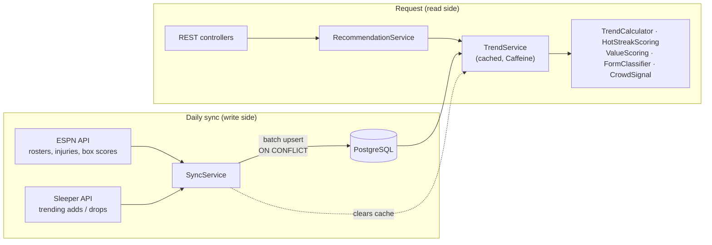
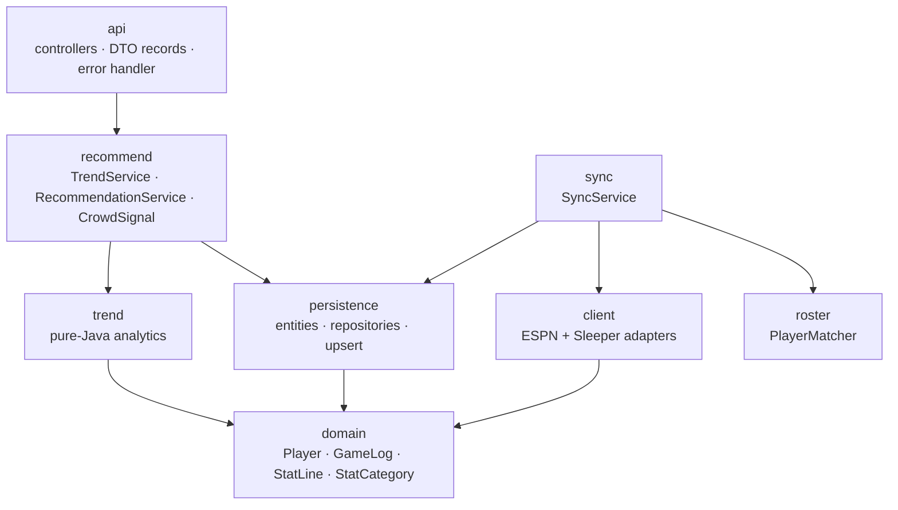

# nba-fantasy-scout


A Spring Boot backend that finds **breakout and declining NBA players** for fantasy basketball. Every day it ingests real
box scores and crowd activity, runs the analytics in plain Java, and serves rankings through a REST API.

> **Status: work in progress.** Ingestion, analytics, the REST API and caching run on real 2026-27 season data.
> Concurrent ingestion and keep / watch / drop advice for your own roster are next (see the [roadmap](#roadmap)).

---

## What it answers

Fantasy managers win by spotting a player whose **role** is growing before everyone else does. The hard part is telling
a real change (more minutes, more shots) from a few lucky games. The service answers two separate questions:

| Question | Number | How |
|---|---|---|
| Is he **better than before**? | **hot score** | last 3 games vs. a baseline of earlier games; weighs minutes, shot attempts and usage, not lucky shooting |
| Is he **good right now**? | **value** | z-scores in the 9 Yahoo fantasy categories against the whole league |

The two numbers become one **form** label (`HOT`, `EARLY_HOT`, `RETURNING`, `GOOD`, `NEUTRAL`, `EARLY_COLD`, `COLD`), which
is then cross-checked with what thousands of fantasy players are adding and dropping (Sleeper trending data).

A real response, four games into the 2026-27 season (`GET /api/v1/recommendations/hot`, trimmed):

```json
{
  "name": "Jayson Tatum",
  "team": "BOS",
  "form": "EARLY_HOT",
  "gamesThisSeason": 4,
  "value": 5.7,
  "hotScore": 0.161,
  "baselineSource": "LAST_SEASON",
  "provisional": true,
  "recent":   { "minutes": 35.7, "points": 33.0, "assists": 7.0, "fieldGoalPct": 0.492 },
  "baseline": { "minutes": 32.6, "points": 21.8, "assists": 5.3, "fieldGoalPct": 0.411 },
  "crowd": { "signal": "EARLY_PICKUP", "move": null, "count": null }
}
```

Four games are too few for a baseline from this season, so the trend is measured against last season and marked
`provisional`. A rookie like Cameron Boozer has no "before" at all: he gets no hot score, but his value is high enough
to be flagged `EARLY_HOT` anyway.

## Engineering highlights

- **Idempotent ingestion.** One batch upsert per player (`INSERT ... ON CONFLICT DO UPDATE ... WHERE ... IS DISTINCT FROM`):
  new games are inserted, stat corrections applied, unchanged rows never rewritten. Upserting an unchanged season again
  changes 0 rows.
- **Failure containment.** Two unofficial external APIs, so failures are expected and graded: a bad row is skipped, a failed
  player is skipped, 10 failures in a row abort the sync, an empty roster response is refused instead of wiping data,
  and an outage of the secondary source never fails the sync.
- **Framework-free domain.** Records and enums with no Spring or JPA: `TrendCalculator`, a `ScoringStrategy` interface with
  interchangeable scorers (Strategy pattern), a z-score `ValueScoring`, a `FormClassifier`. Unit tests run in milliseconds.
- **Real-data calibration.** Thresholds were tuned against live data, not guessed (for example, early-season "cold"
  flags went from 74 players to 47 after two minutes-based rules).
- **Cache-aside with Caffeine.** Recommendations went from ~350 ms to ~35 ms per request; the cache is cleared after every
  sync, including an aborted one (see [lessons](#engineering-decisions-and-lessons)).
- **Clean API.** DTO records (never JPA entities), Bean Validation, RFC 9457 `ProblemDetail` errors, OpenAPI / Swagger UI.
- **Tests against a real database.** Testcontainers runs PostgreSQL 16, because the upsert is Postgres-specific SQL that an
  in-memory database would not run.

## How it works



Writes and reads are separated: requests never call the external APIs, so a slow or broken source cannot slow down a user.
The sync stores only raw counting stats; every average, percentage and score is computed in Java.

## Architecture

Layered, package-by-feature. Each layer only calls the layer below it; controllers never touch repositories.



| Package | Responsibility |
|---|---|
| `domain` | Immutable records and enums, no framework code |
| `trend` | Rolling trend, hot score (Strategy pattern), value z-scores, form classification |
| `client` | `NbaDataClient` interface with an ESPN **adapter**; Sleeper client; JSON mappers tested on saved real responses |
| `roster` | `PlayerMatcher`: matches names across sources that share no id (Unicode normalization + own Levenshtein implementation) |
| `persistence` | JPA entities kept separate from domain records, Spring Data repositories, the JDBC batch upsert |
| `sync` | Daily ingestion with failure containment |
| `recommend` | Loads the data once, runs the analytics, ranks players |
| `api` | REST controllers, DTOs, RFC 9457 errors |
| `config` | Plain-Java services wired with `@Bean` methods; typed `@ConfigurationProperties` records |

## API

| Method | Path | Returns |
|---|---|---|
| `GET` | `/api/v1/recommendations/hot?limit=10` | Rising players (`HOT`, `EARLY_HOT`, `RETURNING`), best value first |
| `GET` | `/api/v1/recommendations/{category}?limit=10` | Biggest improvement in one category (`pts`, `reb`, `ast`, `stl`, `blk`, `threes`, `to`, `fg_pct`, `ft_pct`), case-insensitive |
| `GET` | `/api/v1/players/{id}/trend` | One player by ESPN id |

Interactive docs: **`/swagger-ui.html`** · OpenAPI JSON: `/v3/api-docs`

Errors use [RFC 9457](https://www.rfc-editor.org/rfc/rfc9457) problem details:

```json
{
  "title": "Bad Request",
  "status": 400,
  "detail": "Unknown category \"dunks\"; use one of [FG_PCT, FT_PCT, THREES, PTS, REB, AST, STL, BLK, TO]",
  "instance": "/api/v1/recommendations/dunks"
}
```

## Engineering decisions and lessons

**Two questions need two numbers.** One score cannot say both "better than before" and "good right now": a veteran playing
exactly like last year is good but not hot, and a rookie has no "before". Keeping trend and value separate made both honest.

**The early season.** After three games there is nothing to compare with. The trend falls back to last season's games and
says so (`provisional`); rookies are judged on value alone; players back from a lost season are labelled `RETURNING`
(using ESPN's experience count, added in a Flyway migration); and an early decline only counts when a player with a real
role (18+ minutes) lost at least 15% of his minutes, because minutes settle within a few games and shot volume does not.

**Idempotency checks find real bugs.** The second sync of an unchanged day still rewrote 61 rows. ESPN files the All-Star
games under "Regular Season", up to three of them on one date, and they kept overwriting each other under the
`(player_id, game_date)` key. They don't count in fantasy leagues anyway, so the mapper now filters them out (along with
the Play-In and the NBA Cup final).

**`@CacheEvict` is skipped when the method throws.** The cache was first cleared with `@CacheEvict` on the sync. A test of
the failure path showed the gap: an aborted sync has already saved new data, but the exception skips the eviction, so the
API would serve stale results for up to a day. `beforeInvocation = true` is not a fix either (a request during the sync
would cache half-updated data). The sync now clears the cache in a `finally` block, and a test covers the abort path.

**No global transaction for the sync.** Each save commits on its own, so a failure at player 400 keeps the first 399,
and the idempotent upsert fills the gap on the next run.

**Wrong data is worse than missing data.** Name matching across sources flags weak or tied matches as unsure, and the
sync skips them; a changed ESPN response format fails loudly instead of storing wrong numbers.

## Tech stack

Java 21 (records, switch expressions, streams) · Spring Boot 4.1 (Web MVC, Data JPA, Validation, Cache) · PostgreSQL 16 ·
Flyway · JdbcTemplate · Caffeine · JDK `HttpClient` · Jackson · springdoc-openapi · JUnit 5 · Mockito · Testcontainers ·
Gradle (Kotlin DSL) · Docker Compose

## Run locally

Requires Java 21 and Docker.

```bash
docker compose up -d     # PostgreSQL 16 (dev credentials in docker-compose.yml)
./gradlew bootRun        # starts on :8080; Flyway creates the schema
```

Then open <http://localhost:8080/swagger-ui.html>.

The database starts empty. A manual end-to-end run (the real ESPN and Sleeper sync plus OK/FAIL checks and a printed
report) fills it:

```bash
./gradlew bootRun --args="--spring.profiles.active=demo --spring.main.web-application-type=none"
```

A full sync of all ~520 rostered players takes about 2 minutes today (single-threaded).

## Testing

```bash
./gradlew test           # needs Docker for Testcontainers
```

66 tests in 20 classes:

- **Unit tests** for the domain and analytics (trend windows, baselines, scoring, z-scores, classification, name matching)
- **Mapper tests** on saved real ESPN and Sleeper JSON
- **Mockito** tests of the sync's failure handling (skips, abort, empty roster, secondary source down, cache cleared on abort)
- **Testcontainers** tests of the repositories and the upsert against PostgreSQL 16
- **`@WebMvcTest`** tests of the controllers: JSON shape, validation, 400 and 404 problem details

## Roadmap

- [x] Schema and Flyway migrations
- [x] Ingestion: ESPN rosters, injuries and box scores; Sleeper trending; idempotent upsert
- [x] Analytics: trend, hot score, value, form, crowd signal
- [x] REST API, Swagger UI, problem details, Caffeine cache
- [x] Test suite (unit, Mockito, Testcontainers, `@WebMvcTest`)
- [ ] **Concurrent ingestion**: `CompletableFuture` on a bounded pool, Resilience4j rate limiter and retry, MDC correlation
      ids, a `SyncCompletedEvent`; measure the speedup, platform vs. virtual threads
- [ ] Roster advice: keep / watch / drop with the best free-agent replacement (Chain of Responsibility rules, sealed
      `Recommendation` types), then roster input from screenshots
- [ ] Asynchronous sync endpoint (202 + job status), scheduler, a small web page
- [ ] CI with GitHub Actions

## Data sources

Player data comes from ESPN's public (unofficial, undocumented) site API and from the [Sleeper API](https://docs.sleeper.com/).
Both are free and need no key. This is a personal learning project, not affiliated with ESPN, Sleeper, Yahoo or the NBA.
